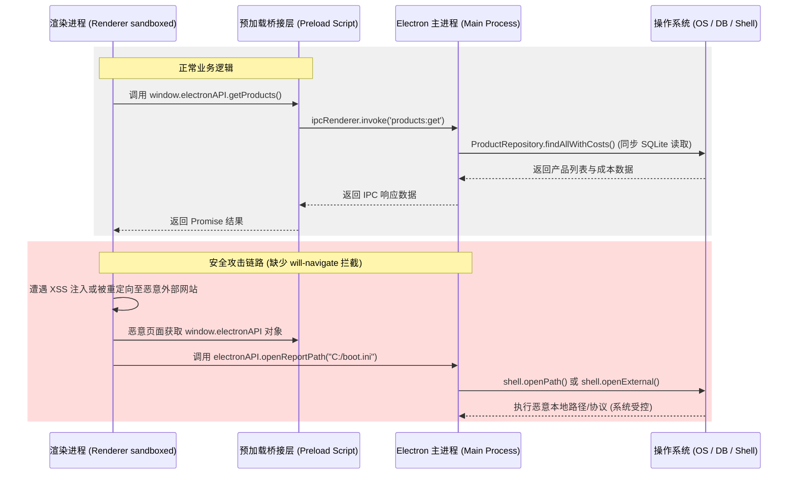

# Electron 应用深度源代码分析报告 (`apps_analysis.md`)

## 1. 概述与核心发现
本报告针对 `apps/desktop/src/` 目录下的 Electron 桌面端应用进行了深入的源代码审计与安全/性能分析。核心发现包括：
- **安全隐患**：缺少关键的主窗口导航限制机制（未监听 `will-navigate` 和 `will-redirect` 事件），导致一旦发生 XSS 或误重定向，暴露的敏感 `electronAPI` 可被恶意站点调用；此外，外部链接处理器直接将任意 URL 传递给操作系统的 `shell.openExternal` 运行，可能引发本地命令执行漏洞。
- **主进程阻塞（SQLite 性能瓶颈）**：数据库采用同步库 `better-sqlite3`。部分数据存储库存在严重的性能缺陷：产品列表查询（N+1 查询问题）和批量入库删除（使用 `COALESCE` 导致索引失效，引发大量的全表扫描），随着本地数据量的增加将直接造成 UI 界面明显冻结。
- **渲染进程性能瓶颈**：由于 React 页面组件中缺少对列定义数组的 `useMemo` 包装，在数据导入和关键词分析页面频繁触发虚拟化表格组件的二次布局重算。
- **代码异味**：对于老版本保留的明文密码，在读取时未做自动加密迁移及明文删除，留下本地敏感信息泄露的漏洞。

---

## 2. 系统进程与 IPC 通信架构

下图展示了当前 Electron 应用中主进程与渲染进程的交互边界、IPC 通信机制以及由于缺少导航拦截可能带来的安全攻击链路：



---

## 3. 安全隐患审计与分析

### 3.1 缺乏导航限制（缺少 `will-navigate` / `will-redirect` 拦截）
- **文件路径**：`apps/desktop/src/main/index.ts`
- **对应行范围**：第 271-306 行（窗口创建与配置部分）
- **漏洞危害**：
  在主窗口 `mainWindow` 初始化时，虽然启用了 `contextIsolation: true` 并禁用了 `nodeIntegration: false`，但没有在窗口的 `webContents` 上监听 `will-navigate` 和 `will-redirect` 事件。
  若应用被注入恶意脚本（XSS）或受到第三方站点跳转劫持，Electron 窗口将被重定向加载非受信的外部 HTML 页面。由于该恶意网页处于主窗口的上下文中，它将依然能够访问预加载脚本注入的全局 `window.electronAPI` 桥接对象。攻击者可以通过此对象调用如读取敏感配置、删除运行事件、触发 shell 执行等所有高危 IPC 通道，导致应用沙箱完全失效。

### 3.2 任意 URL 外部打开风险（`shell.openExternal` 缺乏协议验证）
- **文件路径**：`apps/desktop/src/main/index.ts`
- **对应行号**：第 302-305 行
- **漏洞危害**：
  ```typescript
  // Handle external links
  mainWindow.webContents.setWindowOpenHandler(({ url }) => {
    shell.openExternal(url);
    return { action: 'deny' };
  });
  ```
  主进程直接将捕获到的 `url` 传给了 `shell.openExternal(url)`。如果目标 URL 使用了某些特殊协议（如 `file:///`、`gopher://` 或执行操作系统的某些命令注册的 URL Scheme，例如 `ms-settings:`），`shell.openExternal` 将在操作系统级别打开或执行它。攻击者可以在渲染进程中通过 `window.open("file:///C:/Windows/System32/calc.exe")` 等方式，直接在用户电脑上唤起任何本地程序，构成远程代码执行（RCE）的隐患。

---

## 4. 数据库与主进程性能瓶颈

由于 Electron 主进程是单线程运行的，任何阻塞主线程的操作（如复杂的同步 SQLite 查询或由于写算法缺陷引发的密集 CPU 计算）都会直接打断操作系统的事件轮询，导致主渲染窗口在查询期间产生秒级的“卡死”或鼠标沙漏状态。

### 4.1 ProductRepository 中的 N+1 同步查询问题
- **文件路径**：`packages/local-db/src/sqlite/repositories/product-repo.ts`
- **对应行号**：第 64-69 行
- **源码分析**：
  ```typescript
  findAllWithCosts(storeName?: string): ProductWithCost[] {
    return this.findAll(storeName).map((product) => ({
      ...product,
      cost: this.getCost(product.id),
    }));
  }
  ```
  在通过 `this.findAll(storeName)` 获取到产品列表后，代码使用 `map` 对每个产品实例执行了一次独立的同步查询 `this.getCost(product.id)`。
  - 这是一个非常典型的 **N+1 查询问题**。
  - 在大中型亚马逊店铺中，ASIN 数量通常在数百甚至上千个。这意味着主进程会执行 `N` 次独立的 SQLite 同步 I/O 查询。在主进程单线程模型下，这将引起严重的磁盘读取堆积，造成渲染页面加载产品列表时停顿 1-3 秒。

### 4.2 AdMetricsRepository 批量写入因 COALESCE 导致索引失效并产生全表扫描
- **文件路径**：`packages/local-db/src/sqlite/repositories/ad-metrics-repo.ts`
- **对应行号**：第 30-46 行（以及第 76-92 行）
- **源码分析**：
  ```typescript
  const deleteExisting = this.db.prepare(`
    DELETE FROM ad_daily_metrics
    WHERE COALESCE(batch_id, '') = COALESCE(@batchId, '')
      AND COALESCE(report_type, '') = COALESCE(@reportType, '')
      AND COALESCE(date, '') = COALESCE(@date, '')
      AND COALESCE(store_name, '') = COALESCE(@storeName, '')
      ...
  `);
  ```
  在执行 `insertBatch` 事务时，为了确保幂等性，主进程会对每个指标对象运行一次上面的 `deleteExisting` 删除条件。
  - **索引失效**：`database.exec` 虽然对 `date`、`store_name`/`marketplace_code` 和 `asin` 建立了普通索引。但在 SQL 中，一旦对字段包裹了 `COALESCE(column, '')` 函数，SQLite 就会直接**废弃该字段上的索引**，转而对 `ad_daily_metrics` 执行效率极低的**全表扫描 (Full Table Scan)**。
  - **性能恶化**：广告每日报表数据量极其庞大（动辄数十万条记录）。在一个包含 1000 行指标的批量导入事务中，这会导致主进程连续执行 1000 次针对数十万条记录的全表扫描，使更好 SQLite（`better-sqlite3`）在事务执行期间完全耗尽主进程 CPU，UI 窗口直接失去响应。

---

## 5. 渲染进程性能与 React 组件结构分析

### 5.1 数据导入页面与关键词机会页面的列定义缺少 `useMemo` 缓存
- **文件路径 1**：`apps/desktop/src/renderer/pages/data-import-validation-page.tsx`
  - **对应行号**：第 558 行
  - **现象**：`reportColumns` 直接定义在函数组件 `DataImportValidationPage` 内部。
- **文件路径 2**：`apps/desktop/src/renderer/pages/keyword-opportunities-page.tsx`
  - **对应行号**：第 681 行
  - **现象**：`opportunityColumns` 直接定义在函数组件 `KeywordOpportunitiesPage` 内部。
- **影响评估**：
  在虚拟化大表组件 `VirtualDataTable` 中，列定义（`columns`）是判断整个表格结构和重新计算 `gridTemplateColumns`（第 111 行 `const gridTemplateColumns = useMemo(() => virtualColumnTemplate(columns), [columns])`）的核心依赖项。
  由于上述两个页面没有用 `useMemo` 缓存列数组，导致任何轻微的页面状态变更（如搜索文本框输入、弹窗显示、局部按钮 Loading）触发父页面重新 Render 时，都会生成一个新的列数组对象引用，从而强制 `VirtualDataTable` 执行无效的 DOM 模板计算及虚拟化边界量算，耗费渲染进程的 CPU 资源。

---

## 6. 代码异味 (Code Smells)

### 6.1 遗留明文凭证无安全迁移机制
- **文件路径**：`apps/desktop/src/main/login-credentials.ts`
- **对应行号**：第 91-100 行
- **代码异味**：
  ```typescript
  const legacyPassword = store.get(LEGACY_LOGIN_PASSWORD_KEY);
  if (legacyPassword) {
    return {
      username,
      password: legacyPassword,
      rememberPassword: true,
      passwordAvailable: true,
    };
  }
  ```
  当读取旧版明文密码 `login_password` 时，主进程虽然返回了该明文用于正常业务，但**完全没有执行就地加密并覆写、清空明文存储的操作**。明文密码会永久残留在 SQLite `app_settings` 表中，形成了信息泄露的安全盲区。

---

## 7. 可重构性修复建议

### 7.1 安全性加固：增加主进程导航拦截
在创建窗口时，明确限制其只能访问本地文件或本机的开发服务（`localhost`），杜绝外部加载恶意网页。
**修改建议文件：** `apps/desktop/src/main/index.ts` （约第 286 行后插入）
```typescript
  // 仅允许加载本地应用内容，阻止外部非法导航重定向
  mainWindow.webContents.on('will-navigate', (event, navigationUrl) => {
    const parsed = new URL(navigationUrl);
    if (process.env.NODE_ENV === 'development') {
      if (parsed.hostname !== 'localhost' && parsed.hostname !== '127.0.0.1') {
        event.preventDefault();
      }
    } else {
      if (parsed.protocol !== 'file:') {
        event.preventDefault();
      }
    }
  });

  mainWindow.webContents.on('will-redirect', (event, redirectUrl) => {
    event.preventDefault(); // 拒绝任何动态重定向
  });
```

### 7.2 安全性加固：校验外部打开的 URL 协议
限制只允许打开网络协议（`http` / `https`），杜绝本地命令和系统配置 URL 的执行。
**修改建议文件：** `apps/desktop/src/main/index.ts` （第 302-305 行）
```typescript
  // 严格限制外联打开协议
  mainWindow.webContents.setWindowOpenHandler(({ url }) => {
    try {
      const parsedUrl = new URL(url);
      if (['http:', 'https:'].includes(parsedUrl.protocol)) {
        shell.openExternal(url);
      }
    } catch (e) {
      console.error('阻止打开非法格式的外部URL:', url);
    }
    return { action: 'deny' };
  });
```

### 7.3 数据库重构：优化 N+1 查询为 JOIN 单次查询
通过在 SQLite 中使用 `LEFT JOIN` 将产品和其对应的成本关联查询出来，免去 `map` 里的循环查询。
**修改建议文件：** `packages/local-db/src/sqlite/repositories/product-repo.ts` （第 64-69 行）
```typescript
  findAllWithCosts(storeName?: string): ProductWithCost[] {
    const sql = `
      SELECT p.*,
             c.id as cost_id,
             c.purchase_cost,
             c.first_leg_cost,
             c.fba_fee,
             c.referral_fee_rate,
             c.storage_fee,
             c.other_cost,
             c.current_price,
             c.min_price,
             c.target_net_margin
      FROM products p
      LEFT JOIN product_costs c ON p.id = c.product_id
      ${storeName ? 'WHERE p.store_name = ?' : ''}
    `;
    const rows = storeName 
      ? this.db.prepare(sql).all(storeName) 
      : this.db.prepare(sql).all();

    return rows.map((row: any) => ({
      id: row.id,
      marketplace_code: row.marketplace_code,
      store_name: row.store_name,
      asin: row.asin,
      parent_asin: row.parent_asin,
      msku: row.msku,
      sku: row.sku,
      title: row.title,
      product_stage: row.product_stage,
      status: row.status,
      created_at: row.created_at,
      updated_at: row.updated_at,
      cost: row.cost_id ? {
        id: row.cost_id,
        productId: row.id,
        purchaseCost: row.purchase_cost,
        firstLegCost: row.first_leg_cost,
        fbaFee: row.fba_fee,
        referralFeeRate: row.referral_fee_rate,
        storageFee: row.storage_fee,
        otherCost: row.other_cost,
        currentPrice: row.current_price,
        minPrice: row.min_price,
        targetNetMargin: row.target_net_margin,
      } : undefined
    }));
  }
```

### 7.4 数据库重构：移除不规范的 COALESCE 匹配，改为 NULL 安全比较
在 SQLite 3.32+ 版本中，使用 `IS` 可以做到 null-safe 比较，同时**能够利用该字段上的复合索引**，消除全表扫描。
**修改建议文件：** `packages/local-db/src/sqlite/repositories/ad-metrics-repo.ts` （第 30-46 行）
```typescript
    const deleteExisting = this.db.prepare(`
      DELETE FROM ad_daily_metrics
      WHERE batch_id IS @batchId
        AND report_type IS @reportType
        AND date IS @date
        AND store_name IS @storeName
        AND marketplace_code IS @marketplaceCode
        AND asin IS @asin
        AND msku IS @msku
        AND campaign_name IS @campaignName
        AND ad_group_name IS @adGroupName
        AND targeting IS @targeting
        AND search_term IS @searchTerm
        AND match_type IS @matchType
        AND source_file IS @sourceFile
        AND source_row IS @sourceRow
    `);
```

### 7.5 渲染器重构：将列定义改用 `useMemo` 缓存
缓存静态列配置，防止组件每次重新渲染都触发 `VirtualDataTable` 底层的大量虚拟 DOM 重绘。
**修改建议文件 1：** `apps/desktop/src/renderer/pages/data-import-validation-page.tsx` （第 558-616 行）
```typescript
  const reportColumns = useMemo<Array<VirtualDataTableColumn<DataImportReportRow>>>(() => [
    { key: 'label', header: '报表', width: '170px', sticky: 'left', sortable: true, sortLabel: '报表', cell: (row) => row.label },
    // ... 原本的所有列定义 ...
  ], [openingPathKey, runningImport]); // 仅在状态依赖（如 loading, openingPathKey）变化时重建
```

**修改建议文件 2：** `apps/desktop/src/renderer/pages/keyword-opportunities-page.tsx` （第 681-760 行）
```typescript
  const opportunityColumns = useMemo<Array<VirtualDataTableColumn<KeywordOpportunityView>>>(() => [
    { key: 'asin', header: 'ASIN', width: '112px', sticky: 'left', sortable: true, cell: (row) => row.asin || '-' },
    // ... 原本的所有列定义 ...
  ], [selectedOpportunity]); // 仅在选中的行发生变化时重建
```

### 7.6 代码异味重构：在读取旧版明文密码后立即自动升级加密并清理
**修改建议文件：** `apps/desktop/src/main/login-credentials.ts` （第 91-100 行）
```typescript
  const legacyPassword = store.get(LEGACY_LOGIN_PASSWORD_KEY);
  if (legacyPassword) {
    if (cipher.isEncryptionAvailable()) {
      try {
        // 就地加密覆写并清除明文
        store.set(LOGIN_PASSWORD_ENCRYPTED_KEY, cipher.encrypt(legacyPassword));
        store.delete(LEGACY_LOGIN_PASSWORD_KEY);
      } catch (err) {
        console.error('迁移历史明文密码失败:', err);
      }
    }
    return {
      username,
      password: legacyPassword,
      rememberPassword: true,
      passwordAvailable: true,
    };
  }
```
