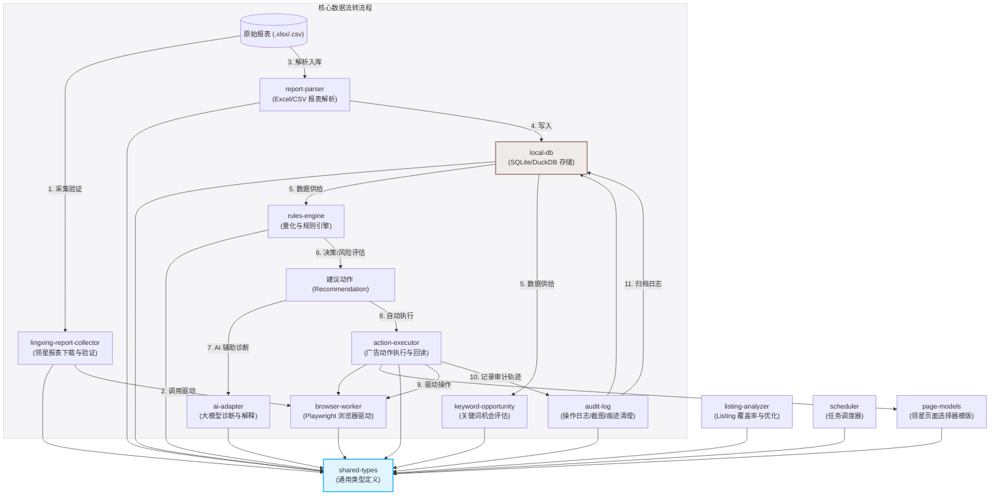

# 亚马逊运营助手 (Amazon AI Ops) 子模块深度源代码分析报告

## 概述
本报告针对 `packages/` 目录下的 13 个核心子模块进行了深度源码静态审计。分析范围涵盖各模块的职责边界、核心文件、内部逻辑实现、模块间的依赖与调用流转关系，并重点识别了系统在性能、并发、安全、代码异味等维度的潜在风险，提供了精确到文件路径及行号的重构建议。

---

## 一、 子模块依赖与数据流转关系 (Mermaid 图表)

以下 Mermaid 架构图描述了 `packages/` 下 13 个子模块的静态依赖关系与核心数据流转：



---

## 二、 13 个子模块的职责与内部逻辑实现深度审计

### 1. action-executor (广告动作执行器)
*   **职责**：负责从系统获取建议的广告动作（降价、提价、加否定词、状态切换），通过 Playwright 驱动浏览器在领星后台执行具体操作，并在执行完成后进行页面值的实时“回读（Verification）”，确保操作生效并生成前后对照的审计数据。
*   **核心文件**：
    *   `src/ad-actions.ts`：广告操作的核心执行器 `AdActionExecutor`。
    *   `src/verifier.ts`：执行后值回读比对类 `Verifier`。
    *   `src/types.ts`：定义执行上下文与返回的审计结果结构。
*   **依赖**：`@amazon-ai-ops/browser-worker`、`@amazon-ai-ops/page-models`、`@amazon-ai-ops/shared-types`、`playwright`。
*   **内部逻辑实现**：
    *   `AdActionExecutor.execute` 接收广告动作类型和 Playwright Page 实例。对于加否定词（`executeAddNegative`），它会依次点击“否词”按钮，填入关键词，点击确认，并等待“成功”Toast 提示。
    *   对于出价微调（`executeAdjustBid`）和开关切换（`executeToggleTarget`），先执行输入或点击，然后调用 `Verifier` 的 `verifyInputValue` 或 `verifyToggle` 方法，在设定的重试次数（默认3次，延迟2000毫秒）内循环查询 DOM 的新状态。

### 2. ai-adapter (大模型适配器)
*   **职责**：包装 OpenAI 兼容的 API 接口，提供专门针对亚马逊广告场景的结构化诊断服务，包括广告动作理由解释（Why）、全量量化广告诊断（Diagnosis）、运营日报生成（Daily Report）以及搜索词相关性分析（Relevance）。
*   **核心文件**：
    *   `src/provider.ts`：提供底层的 `AIProvider` 抽象接口和基础类。
    *   `src/openai-compatible.ts`：适配标准的 ChatCompletion API，并针对 DeepSeek 等特定模型的特性（如 thinking 字段及 response_format 兼容性）进行拦截或参数注入。
    *   `src/ad-strategy-diagnosis.ts`：广告主诊断大类 `AdStrategyDiagnoser`，负责向 LLM 投递全量历史数据并输出结构化的诊断 JSON，附带多层级 JSON 修复与容灾回退逻辑。
    *   `src/ad-action-reason.ts`：解释为何调整出价或加否。
*   **依赖**：`@amazon-ai-ops/shared-types`。
*   **内部逻辑实现**：
    *   在 `ad-strategy-diagnosis.ts` 中，`AdStrategyDiagnoser` 在主请求失败或 JSON 解析失败时，会自动发起第二次“JSON 修复”请求（`parseOrRepairJson`，设置 `temperature: 0`），引导 LLM 对截断或语法错误的文本进行原语义修复。如果修复依然失败，则启用系统自带的本地规则引擎（`fallback`）输出默认配置。

### 3. audit-log (审计日志管理器)
*   **职责**：负责动作执行轨迹的落库审计，同时管理浏览器执行过程中产生的伴生文件（截图、Trace 链路追踪文件），并实现磁盘空间的自动配额管理与过期清理。
*   **核心文件**：
    *   `src/logger.ts`：将执行前、执行后、截图路径等数据写入 SQLite 数据库中的 `action_logs` 表。
    *   `src/screenshot.ts`：计算并管理操作前后的 PNG 截图文件。
    *   `src/trace.ts`：Playwright 性能与动作 Trace 文件的存放路径计算。
    *   `src/cleanup.ts`：根据保留期限配置，定时扫描目录并同步删除过期文件。
*   **依赖**：`@amazon-ai-ops/local-db`、`@amazon-ai-ops/shared-types`、`better-sqlite3`。
*   **内部逻辑实现**：
    *   `CleanupManager` 通过遍历 `screenshots/` 下的 `before`、`after`、`error` 目录以及 `traces/`、`reports/` 目录，通过比对文件的 `mtimeMs`（修改时间戳）与设定保留期，计算出需要被物理删除的文件，执行同步删除，并统计释放的物理字节数。

### 4. browser-worker (自动化浏览器底层驱动)
*   **职责**：封装 Playwright，提供可持久化本地缓存的 Chromium 实例。处理自动化标识规避、Electron 打包环境下的 Chromium 二进制文件路径自动定位、下载文件异步监听器以及断言式元素查找。
*   **核心文件**：
    *   `src/controller.ts`：管理持久化浏览器上下文（Persistent Context）生命周期。
    *   `src/locator.ts`：封装了多套定位器策略的定位引擎。
    *   `src/download-listener.ts`：负责捕获浏览器的文件下载事件。
    *   `src/session-manager.ts`：判定当前领星控制台是否已处于登录态。
*   **依赖**：`playwright`、`@amazon-ai-ops/shared-types`。
*   **内部逻辑实现**：
    *   在启动浏览器时，`BrowserController` 通过 `resolveChromiumExecutablePathForRuntime` 递归查找本机的 LocalAppData 下的 Playwright 二进制目录。如果当前是在 Electron 宿主中打包运行，它会精准识别解压或 unpackaged 的资源路径，并确保使用同一个用户数据目录（`userDataDir`）以重用登录态 Cookie。

### 5. keyword-opportunity (关键词机会引擎)
*   **职责**：负责从广告搜索词和投放报表中提取关键词，经过标准化分词、去重、亚马逊违禁词/绝对词风险校验、Listing 覆盖状态检查后，根据流量与转化率模型对其进行商业机会评分，为后续写入 Listing 的哪个部分提供依据。
*   **核心文件**：
    *   `src/engine.ts`：负责多条报表数据的指标合并与机会评分调度。
    *   `src/scoring.ts`：提供商业机会评分卡公式实现。
    *   `src/risk-checker.ts`：广告文案违规及竞品品牌侵权检测。
*   **依赖**：`@amazon-ai-ops/shared-types`。
*   **内部逻辑实现**：
    *   `scoreKeywordOpportunity` 综合计算转化分（`conversionScore`，基于订单数与转化率）、效率分（`efficiencyScore`，基于 ACOS 高低）、流量分（`trafficScore`，基于点击和展现），并扣减已经覆盖了 Listing 的惩罚分和风险惩罚分，最终折算成 0~100 分。分值在 70 分以上推荐写入标题 (Title) 和主图/描述，40 分以上写入五点描述 (Bullet Points)。

### 6. lingxing-report-collector (领星报表采集器)
*   **职责**：协调并调度 Playwright 浏览器，自动导航到领星 ERP 的下载中心，申请生成历史日期的广告活动、关键词、搜索词等报表，轮询等待报表就绪，下载到本地指定的临时目录，并针对文件名和报表头部特征进行双重完整性校验。
*   **核心文件**：
    *   `src/batch-runner.ts`：单批次报表下载的任务流程协调器。
    *   `src/file-verifier.ts`：提供基于文件名、目录沙箱及内容头部的组合校验。
    *   `src/report-file-inspector.ts`：读取 Excel 前几行识别报表类型的检查器。
    *   `src/diagnostic-evidence-gate.ts`：在执行下载前检测页面模型（PageModel）版本和选择器在 DOM 中的新鲜度与可用性。
*   **依赖**：`@amazon-ai-ops/shared-types`、`xlsx`。
*   **内部逻辑实现**：
    *   `runLingxingReportBatch` 首先在本地生成含有 BatchID 的专用子目录。然后遍历需要采集的报表定义，对每种报表进行多达数次的重试动作。重试的最后一个阶段会启动浏览器级的追踪录制（Playwright Trace）。一旦下载完成，`verifyDownloadedFile` 会通过文件大小过滤掉空文件，使用 `analyzeFilenameDateRange` 校验文件名中的日期范围与用户输入的范围是否一致，并在最后生成 `manifest.json` 索引文件。

### 7. listing-analyzer (Listing 优化分析器)
*   **职责**：将高商业机会的关键词与当前线上的 Listing 文本进行覆盖率比对，智能推荐优化的目标段落，并将未覆盖的词通过规则拼接或 AI 重构方案，合成优化后的 Listing 文本草稿。支持直接导出为 Csv、Xlsx 和 Markdown。
*   **核心文件**：
    *   `src/coverage.ts`：比对 Listing 文本各部分（Title, Bullets, A+ 等）的覆盖率。
    *   `src/rewrite.ts`：基于规则把漏掉的词拼装到现有文本。
    *   `src/draft.ts`：过滤违禁词并在 ASIN + Section 维度对多条修改意见合并成统一草稿。
    *   `src/export.ts`：提供将草稿和建议直接输出至各类电子表格格式的工具。
*   **依赖**：`@amazon-ai-ops/shared-types`、`xlsx`。
*   **内部逻辑实现**：
    *   `buildRuleBasedListingDrafts` 接收当前所有处于 Accepted 状态的建议，通过 ASIN 和 Section（如 title）进行 Grouping。将分词去重后的多个未覆盖关键词合成为文本修改块，使用 `mergeSuggestedText` 方法，如果旧文本没有该词，以追加的形式拼合入原文本，并生成更新的草稿数据。

### 8. local-db (本地双引擎存储库)
*   **职责**：系统核心持久化层，提供双数据库引擎混合存储：
    *   SQLite 负责管理系统参数、产品档案、操作事件、审批流程、AI 执行轨迹及采集批次状态等强事务型关系型数据。
    *   DuckDB 负责进行大数据量的日级广告指标在多维度的极速聚合计算。
*   **核心文件**：
    *   `src/sqlite/db.ts`：SQLite 数据库初始化、升级脚本（Migrations）、以及在多版本合并中的重复键防重安全机制（Duplicate Safeguards）。
    *   `src/duckdb/analytics.ts`：DuckDB 初始化，创建列式计算表与物化视图 `mv_asin_daily`。
    *   `src/sqlite/repositories/`：包含各个业务表的强类型仓储（Repository）实现，例如操作事件仓储、广告日度指标仓储。
*   **依赖**：`better-sqlite3`、`duckdb`、`@amazon-ai-ops/shared-types`。
*   **内部逻辑实现**：
    *   SQLite 在初始化时开启了 WAL (Write-Ahead Logging) 模式，并强制约束外键约束 `foreign_keys = ON`。在升级数据库架构时，通过 `ensureColumn` 动态嗅探并修补新增字段，防止重构导致老数据丢失。
    *   在广告指标仓储（`ad-metrics-repo.ts`）中，为了在导入超大 Excel 时保证极速写入，将冲突处理包裹在 SQLite `transaction` 块内，对于重复导入的行直接以 `deleteExisting` 先删后插，维持其唯一性约束。

### 9. page-models (领星页面声明式模型)
*   **职责**：将脆弱的 Playwright 页面元素定位字符串（CSS/XPath）、页面加载状态断言以及登录判断特征，抽象为与代码逻辑解耦的结构化声明式 JSON 数据。
*   **核心文件**：
    *   `src/lingxing/login.ts`：领星登录页选择器。
    *   `src/lingxing/ad-export.ts`：报表导出中心选择器。
    *   `src/lingxing/ad-targeting.ts`：广告投放详情页选择器。
    *   `src/shared/locator-presets.ts`：通用的按钮、输入框、表格等全局预置模板。
*   **依赖**：`@amazon-ai-ops/shared-types`。
*   **内部逻辑实现**：
    *   页面模型将每一个关键交互元素定义为一个含有 `strategies` 数组的对象。包含 CSS 选择器、XPath 和 Role 三种定位优先级。在运行期定位时，允许执行器在多套方案间回退以应对领星的前端重构。

### 10. report-parser (报表解析引擎)
*   **职责**：读取采集到的原始报表数据（Excel/CSV），标准化表格中的中英文异形字段表头，将字符串数字规整为浮点数/整数，并校验数据的行级格式完整性，输出标准的 `AdDailyMetrics` 强类型内存对象。
*   **核心文件**：
    *   `src/parser.ts`：封装报表格式推断与文件级流读取的主逻辑。
    *   `src/field-mapper.ts`：负责中英文异形表头多对一标准化转换映射。
    *   `src/validators.ts`：验证空行、非法浮点字符及异常指标，并生成校验报告。
*   **依赖**：`xlsx`、`@amazon-ai-ops/shared-types`。
*   **内部逻辑实现**：
    *   `ReportParser.parseSheet` 会通过 `XLSX.utils.sheet_to_json` 将 Excel 或 CSV 的数据行拉进内存。对于每一行，调用 `mapRowFields` 进行键的名称规整（比如把“广告活动名称”、“广告活动”和“Campaign Name”都统一映射为 `campaignName`）。随后，调用 `cleanNumericFields` 清洗无效的 "%"、"$" 和千分位符，并自动填补 `acos`、`cpc` 和 `cvr` 等派生衍生字段。

### 11. rules-engine (量化规则引擎)
*   **职责**：核心决策大脑之一。基于从数据库提取的日度/时间线多维指标，执行经典的亚马逊广告量化阈值分析，产出具体而保守的调整建议（如无转化降价/加否，高转化提价），并进行交叉风险评估与冲突拦截。
*   **核心文件**：
    *   `src/quantification.ts`：执行量化统计与趋势分析的 `AdQuantifier`。
    *   `src/ad-rules.ts`：定义具体的高 ACOS 判定、低效过滤等决策子规则。
    *   `src/recommendation.ts`：将量化结果转换为标准建议对象。
    *   `src/risk-evaluator.ts`：识别高风险出价调整（如出价调高过快、误杀核心词）。
    *   `src/ad-decision-merger.ts`：处理多重规则引起的建议冲突（如提价和降价冲突时合并决策）。
*   **依赖**：`@amazon-ai-ops/shared-types`。
*   **内部逻辑实现**：
    *   `AdQuantifier.quantifyTimeline` 接收一条按时间排序的广告指标历史数组，先在 ASIN + 广告活动 + 广告组 维度进行归一化建索引。然后计算中位周期和前后周期的花费/销售趋势。如果期间产生了多次“无订单点击”，且总花费大于限制门槛（`minSpend`），则识别其状态为“浪费（waste）”，根据规则向外推送 `add_negative_exact` 决策。在输出建议时，调用 `RiskEvaluator` 评估当前的建议动作。如果它调价变动率超出了 `bidAdjustPercent`，或者它没有覆盖在核心白词名单中，就会被打上 `needs_review` 标志，进入人工作业轨道。

### 12. scheduler (后台异步调度器)
*   **职责**：提供进程内的微型后台服务，注册每日推荐计算、每日报告生成、过期资源清理等后台作业，并计算作业的下一个运行周期。
*   **核心文件**：
    *   `src/scheduler.ts`：提供事件总线式的调度器 `LocalScheduler`。
*   **依赖**：Node 本地模块 `events`。
*   **内部逻辑实现**：
    *   `LocalScheduler` 在内存中维护任务状态。在注册任务时，解析简易 Cron 表达式，并在每次任务执行完后，重新调用 `scheduleTask` 设置一个 `setTimeout` 定时器。当触发事件时，通过 Node `EventEmitter` 向主进程发出 `'task:start'`、`'task:complete'` 等生命周期信号。

### 13. shared-types (公共类型定义)
*   **职责**：集中定义了整个工作空间所必须的纯 TypeScript 接口、联合类型和数据契约。
*   **核心文件**：
    *   `src/ad.ts`：广告活动相关的基础接口。
    *   `src/action.ts`：广告调整建议类型的声明。
    *   `src/page-model.ts`：声明式 PageModel 所使用的核心接口。
    *   `src/v1_5.ts`：系统 1.5 版本扩充的新业务实体（如 Listing 分析、采集批次）类型。
*   **依赖**：无。

---

## 三、 核心代码审计：问题与重构建议

以下是本次审计中发现的系统级性能、安全设计隐患和代码异味，已列出具体的文件路径、受影响的行号及重构实现。

### 1. 性能瓶颈与 CPU 阻塞风险

#### A. 报表解析中的低效迭代查找算法 (CPU 性能瓶颈)
*   **文件路径**：`packages/report-parser/src/parser.ts`
*   **受影响行号**：第 133 到 141 行
*   **源码片段**：
    ```typescript
    const getValue = (field: string): any => {
      const lowerField = field.toLowerCase();
      for (const key of Object.keys(row)) {
        if (key.toLowerCase() === lowerField) {
          return row[key];
        }
      }
      return row[field] ?? '';
    };
    ```
*   **问题分析**：
    在大表格解析时，每映射一个字段都需要遍历 row 的所有键。如果表格有 20 个字段，每行有 30 个 Key，表格总计 50,000 行，则该逻辑在单线程的 CPU 上会进行 $20 \times 30 \times 50,000 = 30,000,000$ （三千万次）字符串比对。这属于明显的 $O(N \times F \times H)$ 算法设计缺陷，是导入海量报表时 Electron 应用出现卡死的致命原因。
*   **重构建议**：
    应在数据解析的最前端（`parseSheet` 刚得到行数据时），先提取表头并在 $O(H)$ 复杂度内建立一个“原始表头 -> 目标字段”的映射字典，后续读取时直接进行 $O(1)$ 指针引用。
*   **重构代码示范**：
    ```typescript
    // 在 parseSheet 入口处建立表头映射索引
    const rawKeys = Object.keys(dataRows[0] || {});
    const headerMapping = new Map<string, string>();
    for (const key of rawKeys) {
      headerMapping.set(key.toLowerCase(), key);
    }
    
    // mapToAdMetrics 内部 getValue 优化为：
    const getValue = (field: string): any => {
      const lowerField = field.toLowerCase();
      const matchedKey = headerMapping.get(lowerField);
      return matchedKey ? row[matchedKey] : (row[field] ?? '');
    };
    ```

#### B. 大文件同步 IO 读取与 Excel 加载 (UI 线程阻塞)
*   **文件路径**：`packages/report-parser/src/parser.ts` (第 51 行, 第 66 行) & `packages/lingxing-report-collector/src/report-file-inspector.ts` (第 40 行, 第 49 行)
*   **受影响行号**：
    *   `report-parser/src/parser.ts:51` (`XLSX.readFile(filePath)`)
    *   `report-parser/src/parser.ts:66` (`fs.readFileSync(filePath, 'utf8')`)
    *   `report-file-inspector.ts:40` (`fs.readFileSync(filePath, 'utf8')`)
    *   `report-file-inspector.ts:49` (`XLSX.readFile(filePath)`)
*   **问题分析**：
    在 Electron 主进程中，`XLSX.readFile` 会完全阻塞 Node.js 事件循环来加载大 Excel 文件。如果报表达数十兆大小，UI 渲染主进程将因此出现假死，操作系统会弹出“程序未响应”的提示。此外，同步文件系统扫描（如 `audit-log/src/cleanup.ts:94-103` 中的 `fs.readdirSync` 和 `fs.unlinkSync`）在操作数千个文件时也会对事件循环造成显著阻塞。
*   **重构建议**：
    1. 使用 Node 线程池 `piscina` 或自带的 `worker_threads`，将所有解析 Excel 和 CSV 的繁重工作放到后台独立线程中处理。
    2. 将同步文件读写替换为 `fs.promises.readdir` 和 `fs.promises.unlink` 等异步非阻塞式方法。

---

### 2. 安全隐患与设计缺陷

#### A. 浏览器控制层中危险的 `eval` 代码注入风险
*   **文件路径**：`packages/browser-worker/src/controller.ts`
*   **受影响行号**：第 102 到 107 行
*   **源码片段**：
    ```typescript
    return page.evaluate(
      ({ source, values }) => {
        const pageFunction = (0, eval)(`(${source})`);
        return pageFunction(...values);
      },
      { source: fn.toString(), values: args },
    ) as Promise<T>;
    ```
*   **问题分析**：
    在 Playwright 的沙箱执行空间中使用 `(0, eval)` 来反序列化并调用动态传入的代码串，极易导致代码注入攻击（Remote Code Execution）。如果参数 `fn` 受到不受信任的配置项影响，会在运行期绕过应用的代码静态审查，带来极大的安全隐患。
*   **重构建议**：
    Playwright 本身原生支持对 `page.evaluate(fn, ...args)` 中的函数进行内部序列化，完全没有必要在前端重新拼接字符串进行 `eval`。应当直接使用 Playwright 原生的参数传递链。
*   **重构代码示范**：
    ```typescript
    async evaluate<T = unknown>(fn: string | Function, ...args: any[]): Promise<T> {
      const page = this.getPageOrThrow();
      if (typeof fn === 'string') {
        // 如果必须支持字符串表达式，使用安全的 page.evaluate(fn)
        return page.evaluate(fn, args) as Promise<T>;
      }
      return page.evaluate(fn as any, args) as Promise<T>;
    }
    ```

#### B. 错误的定位器（Locator）空选择器与无效 Stringify 判定
*   **文件路径**：`packages/action-executor/src/ad-actions.ts`
*   **受影响行号**：第 178 行及第 253 行
*   **源码片段**：
    ```typescript
    const verified = await this.verifier.verifyInputValue(
      { id: 'bid-input', strategies: [{ type: 'css', value: await bidInputOrAlt.locator('').toString() }] },
      targetBid.toFixed(2),
      verifyOpts
    );
    ```
*   **问题分析**：
    1. `bidInputOrAlt.locator('')` 传入空字符串是 Playwright 的非法用法，会导致引擎抛出 `page.locator: Locator cannot be empty` 的运行时崩溃异常。
    2. 在 Locator 实例上直接调用 `.toString()` 返回的是 Playwright 用于调试的内部输出文本（形如 `Locator@css=input[class*="bid"]`），而不是原生的 CSS 选择器字符串。这导致传入 `Verifier` 的 CSS 值是一个完全错误的废弃定位文本，引起后续的值校验阶段（`verifier.verifyInputValue`）必定因找不到元素而失败或回退。
*   **重构建议**：
    不应尝试将运行中的 Playwright Locator 反向转换为选择器文本。相反，应当在创建 Locator 之前保留原始的 Selector 选择器字符串；或者直接向 `Verifier` 传递已经查找到的 `Locator` 对象本身，而不是传递包含无效 CSS 文本的 `ElementLocator` 参数。
*   **重构代码示范**：
    在 `verifier.ts` 中直接支持 Locator 实例：
    ```typescript
    // verifier.ts 重构为支持传入 Locator
    async verifyInputValueByLocator(
      locator: Locator,
      expectedValue: string,
      options: Partial<VerifyOptions> = {}
    ): Promise<boolean> {
      const opts = { ...DEFAULT_VERIFY_OPTIONS, ...options };
      for (let i = 0; i < opts.retries; i++) {
        try {
          const currentValue = await locator.inputValue();
          if (this.valuesMatch(currentValue, expectedValue, opts.tolerance)) {
            return true;
          }
          await this.page.waitForTimeout(opts.retryDelayMs);
        } catch {
          await this.page.waitForTimeout(opts.retryDelayMs);
        }
      }
      return false;
    }
    ```
    在 `ad-actions.ts` 中直接传入定位器对象进行回读：
    ```typescript
    const verified = await this.verifier.verifyInputValueByLocator(
      bidInputOrAlt,
      targetBid.toFixed(2),
      verifyOpts
    );
    ```

---

### 3. 并发冲突与竞态条件

#### A. 共享浏览器页面会话引起的资源抢占
*   **涉及模块**：`action-executor` 与 `browser-worker`
*   **问题分析**：
    `BrowserController` 在全局（或当前会话）只维护了一个主 `Page` 对象实例。在规则触发并发操作时，如果系统同时执行两个“自动广告动作”或“多个报表任务”，多个执行程序会同时尝试调用该单一 `Page` 去点击元素或进行页面跳转（如 `executeAddNegative` 和 `executeAdjustBid` 抢夺焦点）。这会破坏页面原有的 DOM 会话，导致操作在混乱中点击失败、数据错乱，甚至回读到错误对象的值。
*   **重构建议**：
    1. 为 `BrowserController` 引入互斥锁（Mutex），对需要占用页面前台流转的操作进行排队。
    2. 执行动作前由主驱动分配独立私有的 `BrowserContext` 或新开 Tab 页（Page），任务完成后立刻销毁，实现会话级隔离。

---

### 4. 代码异味 (Code Smells)

#### A. 定位选择器多路回退策略设计失效 (Broken Fallback)
*   **文件路径**：`packages/browser-worker/src/locator.ts`
*   **受影响行号**：第 9 到 18 行
*   **源码片段**：
    ```typescript
    for (const strategy of locator.strategies) {
      try {
        const result = await this.tryStrategy(strategy, timeout);
        if (result) return result;
      } catch (e) {
        continue;
      }
    }
    ```
*   **问题分析**：
    `this.tryStrategy` 方法在执行 `this.page.locator()` 时是同步非阻塞的，即便该元素在当前的真实 DOM 中根本不存在，Playwright 也会立刻返回一个 `Locator` 句柄对象。因为返回的 `result` 永远是一个有效的 `Locator` 实例（即为真值），所以该 `for` 循环总是能够匹配上第一条策略并立刻跳出，多路回退的逻辑实际上完全没有生效。
*   **重构建议**：
    应当在获取到 `Locator` 句柄后，真正发起一次轻量级的挂载嗅探或可见性探测（例如判定 `count()` > 0 或设置一个短超时时间的 `waitFor({ state: 'attached' })`），确保该策略对应的元素确实存在，再跳出循环。
*   **重构代码示范**：
    ```typescript
    private async tryStrategy(strategy: LocatorStrategy, timeout: number): Promise<Locator | null> {
      let locator: Locator;
      switch (strategy.type) {
        case 'css':
          locator = this.page.locator(strategy.value).first();
          break;
        // 其他分支保持一致...
      }
      
      // 检测该定位器指向的元素是否确实能够挂载
      try {
        await locator.waitFor({ state: 'attached', timeout });
        return locator;
      } catch {
        return null;
      }
    }
    ```

#### B. 简易 Cron 表达式解析器在通用符号（`*`）上的算术越界崩溃
*   **文件路径**：`packages/scheduler/src/scheduler.ts`
*   **受影响行号**：第 195 到 196 行
*   **源码片段**：
    ```typescript
    next.setSeconds(parts.second ? parseInt(parts.second) : 0);
    next.setMinutes(parts.minute ? parseInt(parts.minute) : next.getMinutes() + 1);
    ```
*   **问题分析**：
    当传入的 Cron 表达式包含常见的通配符时，例如每小时执行一次的 `0 * * * *`，`parts.minute` 的值会是字符串 `"*"`。这会导致 `parseInt("*")` 计算得到 `NaN`。此时调用 `next.setMinutes(NaN)` 会使 `next` 时间对象彻底失效，变为运行时 `Invalid Date`，从而导致后续计算调度时长（`delay`）得出错误数据，甚至引发死循环和崩溃。
*   **重构建议**：
    该简易 Cron 逻辑仅能支持纯固定的数字格式表达式。重构时应采用成熟的社区方案如 `cron-parser`；如果必须自研，在解析通配符（如 `*`）或步长（如 `*/5`）时应增加分支逻辑判断。
*   **重构代码示范**：
    ```typescript
    const parsedMinute = parseInt(parts.minute);
    if (!isNaN(parsedMinute)) {
      next.setMinutes(parsedMinute);
    } else {
      // 命中 * 通配符，自动向下推进一分钟
      next.setMinutes(next.getMinutes() + 1);
    }
    ```

#### C. 大量冗余且无实际引用的死代码：DuckDB
*   **文件路径**：`packages/local-db/src/duckdb/analytics.ts`
*   **受影响行号**：第 13 到 83 行 (初始化 `mv_asin_daily` 视图等代码)
*   **问题分析**：
    系统在 `analytics.ts` 中精心设计了 DuckDB 初始化，并创建了包含物化视图 `mv_asin_daily` 的各种分析表。但经检索，整个项目中（除入口层导出外）没有任何业务仓储或上层模块（如 `rules-engine` 或 `report-parser`）去真正往 DuckDB 插入、读取或同步数据。所有的多维报表分析依然完全依赖慢速的本地 SQLite 进行聚合计算。这种“初始化却不使用”的设计构成了典型的代码冗余，不仅增加了包体积，还带来了无谓的维护成本。
*   **重构建议**：
    若后续需要处理大规模报表，应当将 `report-parser` 解析出来的数据异步导入到 DuckDB 的 `ad_daily_metrics` 列存表中，并将 `rules-engine` 的多维看板计算重构为直接从 DuckDB 的物化视图 `mv_asin_daily` 中进行查询。如果彻底弃用，则应安全移除该 DuckDB 相关的定义和依赖。

---

## 四、 结论与总结

1. **核心逻辑机制健全，但工程实现存在设计疏忽**：
   项目在架构上成功实现了声明式页面模型（`page-models`）、多定位器回退策略、广告量化决策引擎以及错误 JSON 的大模型自动闭环修复，设计理念非常先进。但是，在底层的代码实现上（如 Locator Fallback 判断的物理缺失、Locator 错用空字符串 stringify 导致回读实效）等问题，直接导致了部分业务闭环在实际运行中无法按照预期路径流转。
2. **严重的性能缺陷易导致客户端假死**：
   在 CPU 计算逻辑（`ReportParser` 每行高频查键）和文件读取逻辑（`XLSX.readFile` 同步读取数十万行单元格）中的多处串行同步阻塞式操作，是 Electron 桌面端在大规模报表场景下出现卡死和黑屏的关键症结。
3. **安全防线急需修补**：
   `BrowserController` 中对运行时动态函数使用 `(0, eval)` 的反序列化方法违背了安全生产规范，建议立即进行无污染的安全替代。

---
*报告编制智能体：teamwork_preview_explorer*  
*编制时间：2026-07-17T13:50:18+08:00*
